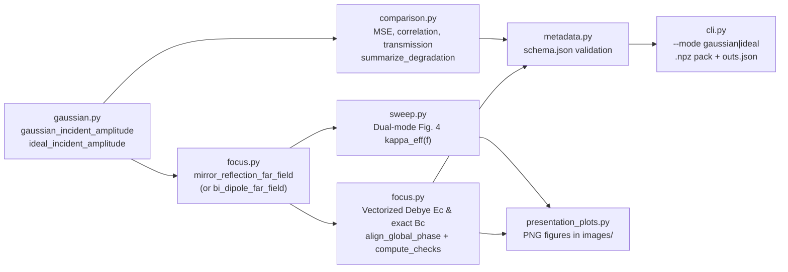

# `src/optics` Architecture & Reference

`src/optics` implements the bi-dipole focusing, parabolic-mirror Gaussian beam-shaping, and focal-field generation half of `fsqed-laser-electron`, reproducing Olofsson & Gonoskov, *"Attaining a strong-field QED signal at laser-electron colliders with optimized focusing"*, Phys. Rev. A **106**, 063512 (2022).

It is decoupled from `src/particles`: the two packages communicate solely through compressed `.npz` **field packs** validated against `data/schema.json`.

---

## 1. Pipeline Overview



---

## 2. Global Conventions

- **Units:** All stored arrays, grids, frequencies, fields, and powers are in **SI units** ($\mathrm{m}$, $\mathrm{s}$, $\mathrm{rad/s}$, $\mathrm{V/m}$, $\mathrm{T}$, $\mathrm{W}$). Dimensionless ($a_0$, $\kappa$, $\chi$, $f$-number) and reference electron energy ($\mathrm{GeV}$) quantities are explicitly named.
- **Axes & Geometry:** Field arrays use slow-to-fast layout `(Nf, 3, Nz, Ny, Nx)` with spatial axes `(z, y, x)` and vector components `(x, y, z)` on axis `1`. Each spatial axis uses the centered even-grid convention `_centered_axis(span_m, npts)` (`step = span_m / npts`, `start = -(npts // 2) * step`, requiring even `Nx, Ny, Nz >= 2`). The laser propagates along $-\hat{\mathbf{y}}$ (converging from the $n_y < 0$ hemisphere to the focus at the origin) with linear polarization along $+\hat{\mathbf{z}}$ and magnetic field along $-\hat{\mathbf{x}}$, counter-propagating against electrons entering along $+\hat{\mathbf{y}}$.
- **Time-Harmonic Phasors:** Complex field phasors follow the $e^{+i\omega t}$ convention, $\mathbf{E}(\mathbf{r}, t) = \mathrm{Re}\!\left[\mathbf{E}_c(\mathbf{r})\,e^{+i\omega t}\right]$, under which Faraday's law gives $\mathbf{B}_c = \frac{i}{\omega}\nabla\times\mathbf{E}_c$.
- **Pulse Envelope:** Pulse durations $\tau_{\mathrm{FWHM}}$ use **intensity FWHM**; the Gaussian field-envelope width is $\sigma_t = \tau_{\mathrm{FWHM}} / \sqrt{4\ln 2}$ (`FWHM_TO_FIELD_SIGMA`), defaulting to `tau_fwhm_s = 30.0e-15` (or computed from `--n-cycles` via `tau_fwhm_from_cycles(n_cycles, lambda0_m)`).
- **f-Number & Aperture:** The parabolic mirror f-number is $f = L / (2 R_{\max})$ ($L$ focal length, $R_{\max}$ mirror radius). A paraxial ray at radius $R$ reflects at angle $\theta$ from the $-\hat{\mathbf{y}}$ axis with $R = 2L\tan(\theta/2)$, giving semi-aperture angle $\theta_{\max} = 2\arctan(1 / (4f))$ (`f_number_to_theta_max`); $f = 0.25$ yields $\theta_{\max} = \pi/2$ (full $-\hat{\mathbf{y}}$ hemisphere), and $f < 0.25$ opens past $\pi/2$ into $n_y > 0$ up to $\theta < \pi$.

---

## 3. Module Breakdown

| Module | Key Exports | Responsibility |
| :--- | :--- | :--- |
| `constants.py` | `C_LIGHT`, `ETA_0`, `E_CRIT`, `B_CRIT`, `MC2_GEV`, `GAMMA_PER_GEV`, `FWHM_TO_FIELD_SIGMA`, `A_DIPOLE_1PW_1UM`, `A_BIDIPOLE_1PW_1UM`, `KAPPA_BIDIPOLE_MAX`, `PAPER_FIG4_LASER`, `PAPER_FSQED_LASER`, `UNAL_TISAPPHIRE_LASER`, `omega_from_lambda`, `period_from_lambda`, `relativistic_field_scale`, `e_field_to_a0`, `a0_to_e_field`, `tau_fwhm_to_sigma_t`, `tau_fwhm_from_cycles`, `energy_gev_to_gamma`, `theoretical_chi_max` | Self-contained CODATA SI constants, Schwinger scales, paper constants ($\kappa_{\max} = 5.25$, $a_{\mathrm{bidipole,1PW}} = 780/\sqrt{2}$), Paper/UNAL laser presets, and unit/Eq. (1) scaling helpers. |
| `focus.py` | `bi_dipole_far_field`, `f_number_to_theta_max`, `mirror_normal`, `reflect`, `align_global_phase`, `focal_field_angular_spectrum`, `focal_field_slice`, `magnetic_field_from_curl`, `field_power_through_y_plane`, `expected_net_y_flux`, `compute_checks`, `mirror_reflection_far_field`, `ideal_far_field`, `gaussian_far_field` | Analytic bi-dipole far field (`z-linear` & `circular`), parabolic-mirror reflection pipeline, vectorized ring-factored Debye $(\theta, \phi)$ quadrature (`Ec` & exact `Bc`), global phase alignment, signed net Poynting flux, and instantaneous-field self-checks. |
| `gaussian.py` | `gaussian_source`, `apodizer`, `gaussian_incident_amplitude`, `ideal_incident_amplitude` | Normalized-radius ($r = R/R_{\max}$) incident beam profiles: collimated Gaussian beam, super-Gaussian/hard apodizer, realistic incident amplitude, and analytic Sheppard–Larkin reference amplitude. |
| `comparison.py` | `incident_intensity_profiles`, `compare_profiles`, `aperture_transmission`, `apodizer_transmission`, `total_transmission`, `summarize_degradation` | Quantitative degradation metrics comparing realistic (Gaussian $\times$ apodizer) vs. ideal Sheppard–Larkin incident intensity profiles: circular-disk area-weighted MSE, RMSE, Pearson correlation, and aperture/apodizer power transmission. |
| `sweep.py` | `focal_field_vector`, `ideal_far_field_builder`, `gaussian_far_field_builder`, `gaussian_transmission`, `kappa_eff_vs_f_number`, `f_number_to_opening_angle_deg`, `default_f_number_sweep` | Fast on-focus ($\mathbf{r}=\mathbf{0}$) Debye evaluation, dual-mode & dual-polarization $\kappa_{\mathrm{eff}}(f\text{-number})$ scan with optional transmission losses across `[0.02, 2.0]` (Fig. 4). |
| `metadata.py` | `load_schema`, `validate`, `build_metadata` | Builds `schema_version: "1.0"` metadata dicts (merging collision-checked `extra` fields) and validates the complete dict against `data/schema.json` before returning (`jsonschema` with built-in draft-07 fallback `_validate_local`). |
| `cli.py` / `__main__.py` | `default_parameters`, `build_far_field`, `generate_field_pack`, `save_field_pack`, `main` | CLI entrypoint (`pixi run python -m src.optics`) supporting `--preset paper\|unal`, `--mode gaussian\|ideal`, `--pol z-linear\|circular`, `--account-for-losses`, `--tau-fwhm-s`, and `--n-cycles`, generating compressed `data/f{f_number}.npz` field packs and `outs.json`. |
| `presentation_plots.py` | `image_focal_intensity`, `image_convergence`, `image_profile`, `image_kappa_sweep`, `image_farfield`, `image_incident_profile`, `image_unal_vs_paper_comparison`, `main` | Matplotlib script generating 7 presentation/comparison PNGs in `images/` (including ideal vs. Gaussian comparisons for both Paper FSQED and UNAL Ti:Sapphire lasers). |

`src/optics/__init__.py` re-exports the submodules `constants`, `focus`, `gaussian`, `sweep`, `comparison`, and `metadata`, along with the CLI functions `default_parameters`, `generate_field_pack`, `save_field_pack`, and `main`.

---

## 4. How Each Stage Works

### 4.1 Far-Field Models & Mirror Reflection (`focus.py`, `gaussian.py`)
- **`bi_dipole_far_field(n)`:** Evaluates Eqs. (9)–(10) of Olofsson & Gonoskov (2022) for the Sheppard–Larkin electric-plus-magnetic dipole far field ($\mathbf{E}^e = (\hat{\mathbf{z}}\times\mathbf{n})\times\mathbf{n}$, $\mathbf{E}^b = \hat{\mathbf{x}}\times\mathbf{n}$). Given unit ray-propagation vectors $\mathbf{n} = (n_x, n_y, n_z)$ — under the $e^{+i\omega t}$ convention each plane-wave kernel $e^{-ik\,\mathbf{n}\cdot\mathbf{r}}$ propagates along $+\mathbf{n}$, and the corresponding mirror point sits at $-\mathbf{n}$ from the focus (origin inversion), so $n_y < 0$ for $\theta < \pi/2$ — it returns:
  $$\mathbf{E}_{\mathrm{ff}}(\mathbf{n}) = \bigl(n_x n_z,\ n_z(n_y - 1),\ n_y - n_x^2 - n_y^2\bigr)$$
  which satisfies $\mathbf{n}\cdot\mathbf{E}_{\mathrm{ff}} = 0$ identically.
- **Parabolic-Mirror Geometry:** `f_number_to_theta_max(f_number)` computes $\theta_{\max} = 2\arctan(1 / (4 f\text{-number}))$. `mirror_normal(n)` computes the local parabolic-mirror normal $\mathbf{N} = (\hat{\mathbf{y}} - \mathbf{n}) / |\hat{\mathbf{y}} - \mathbf{n}|$, and `reflect(E, N)` applies local-normal polarization rotation $\mathbf{E}^p = \mathbf{E} - 2(\mathbf{E}\cdot\mathbf{N})\mathbf{N}$.
- **`mirror_reflection_far_field(n, *, f_number, incident_amplitude)`:** Maps each ray direction $\mathbf{n}$ ($\cos\theta = -n_y$) to normalized mirror radius $r = R/R_{\max} = \tan(\theta/2)/\tan(\theta_{\max}/2)$, evaluates `incident_amplitude(r)` along $+\hat{\mathbf{z}}$, reflects via `reflect(..., mirror_normal(n))`, and multiplies by the parabolic mirror's energy-conserving amplitude Jacobian $2/(1+\cos\theta)$. Supports $f < 0.25$ ($\theta > \pi/2$, $n_y > 0$) and guards against the $\theta = \pi$ ($1+\cos\theta \le 0$) singularity.
- **Ideal vs. Gaussian Pipelines:**
  - `gaussian_far_field(n, *, f_number, w0_over_rmax=0.7, apod_order=8.0)` reflects `gaussian.gaussian_incident_amplitude` off the parabolic mirror and serves as the default `--mode gaussian` pipeline.
  - `ideal_far_field(n, *, f_number)` reflects `gaussian.ideal_incident_amplitude` (Eq. 13) and reproduces `bi_dipole_far_field` up to a constant factor (verified in `tests/test_optics.py`).

### 4.2 Vectorial Focal-Field Integral, Exact $\mathbf{B}_c$ & Checks (`focus.py`)
- **Vectorized Singularity-Free Debye Quadrature (`focal_field_angular_spectrum`, `focal_field_slice`):** Evaluates the exact non-paraxial Debye / Richards–Wolf integral on a midpoint $\theta \in (0, \theta_{\max})$ grid (`ntheta`) and uniform $\phi \in [0, 2\pi)$ grid (`nphi`), with $\mathbf{n} = (\sin\theta\cos\phi, -\cos\theta, \sin\theta\sin\phi)$ and solid-angle weights $w = \sin\theta\,\Delta\theta\,\Delta\phi$. Parameterizing directly in $(\theta, \phi)$ avoids the $1/k_y$ Jacobian pole at the $\mathrm{NA}=1$ ($f = 0.25$) rim. In `focal_field_angular_spectrum`, each $\theta$-ring factors the 3D phase $e^{-ik\,\mathbf{n}\cdot\mathbf{r}}$ into 1D phase arrays along `X`, `Z`, and `Y`, contracting azimuthally with `np.einsum("pc,pz,px->czx", ...)` before outer-multiplying by `ph_y`.
- **Power Normalization & Exact $\mathbf{B}_c$:** Computes $I_2 = \sum_{\theta,\phi} w\,|\mathbf{E}_{\mathrm{ff}}(\mathbf{n})|^2$ and $C_{\mathrm{scale}} = \sqrt{2\eta_0 P / I_2}$ so total incoming power equals `power_w`. Because each plane wave $e^{-ik\mathbf{n}\cdot\mathbf{r}}$ has $\mathbf{k} = -k\mathbf{n}$, Faraday's law $\mathbf{B}_c = \frac{i}{\omega}\nabla\times\mathbf{E}_c$ gives $\mathbf{B}_{\mathrm{far}}(\mathbf{n}) = +\frac{1}{c}\,\mathbf{n}\times\mathbf{E}_{\mathrm{far}}(\mathbf{n})$ algebraically. Both $\mathbf{E}_c$ and exact $\mathbf{B}_c$ are accumulated simultaneously in the Debye loop:
  $$\mathbf{E}_c(\mathbf{r}) = -\frac{i}{\lambda_0} C_{\mathrm{scale}} \sum_{\theta,\phi} w\,\mathbf{E}_{\mathrm{ff}}(\mathbf{n})\,e^{-ik\,\mathbf{n}\cdot\mathbf{r}}, \qquad \mathbf{B}_c(\mathbf{r}) = -\frac{i}{\lambda_0 c} C_{\mathrm{scale}} \sum_{\theta,\phi} w\,\bigl(\mathbf{n}\times\mathbf{E}_{\mathrm{ff}}(\mathbf{n})\bigr)\,e^{-ik\,\mathbf{n}\cdot\mathbf{r}}$$
  returning `(Ec, Bc)` of shape `(1, 3, Nz, Ny, Nx)` (`complex128`). `magnetic_field_from_curl` (central finite differences via `np.gradient`) is retained as a standalone helper and cross-check (`tests/test_optics.py::test_curl_b_matches_direct_b`). `focal_field_slice` evaluates $\mathbf{E}_c$ on a 2D `"y"`, `"x"`, or `"z"` slice for fast visualization.
- **Global Phase Alignment (`align_global_phase`):** Rotates `(Ec, Bc)` by a single unit scalar $\mathrm{conj}(E_{\mathrm{ref}}) / |E_{\mathrm{ref}}|$ chosen from the dominant component at the peak of $|\mathbf{E}_c|$ so that peak $\mathbf{E}_c$ is real and positive at $t = 0$. This enforces synchronous peaking at $t_{\mathrm{ref}} = 0$ while preserving Maxwell's equations and all relative $\mathbf{E}$–$\mathbf{B}$ phases.
- **Poynting Flux & Self-Checks (`field_power_through_y_plane`, `compute_checks`):**
  - `a_max` and `chi_max_per_GeV` are evaluated from the real instantaneous electric field at `t_ref_s` (matching `src.particles.fields._compute_peak_e_at_t_ref`) so circular polarization reports the true rotating field amplitude $E_0/\sqrt{2}$.
  - `a_max_expected = A_BIDIPOLE_1PW_1UM * pol_scale * sqrt(power_w / 1e15)` (`pol_scale = 1/sqrt(2)` for `"circular"`); when `f_number` is passed to `compute_checks`, it is additionally scaled by the truncated bi-dipole aperture factor `sqrt((8 - (1 + cos zeta)^3) / 8)` with `zeta = f_number_to_theta_max(f_number)` (matching `src.particles.fields._truncated_bidipole_kappa`).
  - `power_conservation_rel_err = abs((-p0) - power_w) / power_w`, comparing focal-plane Poynting flux `p0` at `iy = Ny // 2` ($S_y = \mathrm{Re}(E_z B_x^* - E_x B_z^*) / (2\mu_0) < 0$ for $-\hat{\mathbf{y}}$ propagation) against the `expected_y_flux_w` target when provided, else `power_w` (the residual measures transverse grid truncation of outer wings, e.g. $\sim 1.5\%$ at default $64^3$ / $6.4\,\mu\mathrm{m}$ box). For deep mirrors ($f < 0.25$, $\theta_{\max} > \pi/2$), `expected_net_y_flux` computes the *signed* net far-field flux across the focal plane — backward rays ($n_y > 0$) cross $y = 0$ in the $+y$ direction and partially cancel the $-y$ flux — so the check stays meaningful past the hemisphere aperture.
  - `max_location_m`: peak coordinates in meters.
- **Polarizations (`"z-linear"`, `"circular"`):**
  - Both `bi_dipole_far_field` and `mirror_reflection_far_field` support `"z-linear"` and `"circular"` ($\mathbf{E}_{\mathrm{ff}}^{(z)} + i\,\mathbf{E}_{\mathrm{ff}}^{(x)}$ superposition, matching `src.particles.fields` handedness and $\mathbf{B}_c(0) = \frac{i}{c}\mathbf{E}_c(0)$).

### 4.3 Dual-Mode f-Number Sweep (`sweep.py`)
- `focal_field_vector` evaluates the Debye integral only at $\mathbf{r} = \mathbf{0}$ (where $e^{-ik\mathbf{n}\cdot\mathbf{r}} = 1$, so all rays interfere in phase: $\mathbf{E}_c(\mathbf{0}) = -\frac{i}{\lambda_0} C_{\mathrm{scale}}\sum_{\theta,\phi} w\,\mathbf{E}_{\mathrm{ff}}(\mathbf{n})$), making aperture scans cheap.
- `kappa_eff_vs_f_number` scans `f_numbers` (default `default_f_number_sweep()`: `0.02 .. 2.0`, matching PDF Fig. 4 opening angles $\sim 171^\circ \to 14.25^\circ$) at configurable `(lambda0_m, power_w, energy_gev)`, accepting `far_field_builder(f_number) -> far_field(n)` and `power_transmission` (scalar or `callable(f_number) -> T` from `gaussian_transmission()`). At $f = 0.02$, the ideal baseline reaches $\kappa_{\mathrm{eff}} \approx 5.255$ (`KAPPA_BIDIPOLE_MAX = 5.25`); at $f = 0.25$, ideal reaches $\kappa_{\mathrm{eff}} \approx 4.915$ while realistic Gaussian yields lower $\kappa_{\mathrm{eff}}$ from both spatial profile mismatch and aperture/apodizer power loss.

### 4.4 Incident Profiles & Degradation Comparison (`gaussian.py`, `comparison.py`)
- `gaussian.py` defines normalized-radius ($r = R/R_{\max}$) profiles independent of mirror focal length:
  - `gaussian_source(R, w0)`: collimated amplitude $\exp(-(R/w_0)^2)$ ($1/e$ field radius $w_0$).
  - `apodizer(R, R_max, order=1.0)`: super-Gaussian transmission $\exp(-(R/R_{\max})^{2\,\mathrm{order}})$.
  - `gaussian_incident_amplitude(r_over_rmax, *, w0_over_rmax, apod_order)`: `gaussian_source(r, w0_over_rmax) * apodizer(r, 1.0, order=apod_order)`.
  - `ideal_incident_amplitude(r_over_rmax, *, f_number)`: $\bigl((r / (4 f\text{-number}))^2 + 1\bigr)^{-2}$, i.e., $\sqrt{I^p(R)}$ from Eq. (13).
- `comparison.py` quantifies the mismatch between realistic and ideal incident intensity profiles over $r \in [0, 1]$:
  - `incident_intensity_profiles(...)`: returns `(R, I_ideal, I_real)`.
  - `compare_profiles(I_ideal, I_real, R)`: normalizes both profiles to unit total radial power ($\int I(R)\,R\,dR$ via `np.trapezoid`, raising `ValueError` on a non-positive total) and returns area-weighted ($R\,dR$) `{"mse", "rmse", "relative_rmse", "correlation"}`, where `relative_rmse = rmse / mean_ideal` after the normalization.
  - `aperture_transmission`, `apodizer_transmission`, and `total_transmission`: compute mirror-aperture enclosure fraction $1 - e^{-2/w^2}$, in-aperture apodizer transmission, and total source-to-focus power transmission.
  - `summarize_degradation(...)`: combines `mse`, `rmse`, `relative_rmse`, `correlation`, `transmission` (apodizer-only, in-aperture), `aperture_transmission`, `total_transmission` (apodizer $\times$ aperture truncation), and `f_number` into the `degradation` metadata block.

### 4.5 Metadata, CLI & Plots (`metadata.py`, `cli.py`, `presentation_plots.py`)
- `metadata.py`: `build_metadata` constructs the `schema_version: "1.0"` dict (`grid`, `freqs=[omega0]`, `power_W`, `f_number`, `lambda0_m`, `pol`, `pulse` with `convention="intensity_fwhm"`, `checks`, plus non-schema reporting keys `convention`, `theta_max_rad`, optional `n_cycles`, `R_max_m`, and collision-checked `extra` fields), then validates the **full** metadata dict against `data/schema.json` via `validate` before returning.
- `cli.py` (`pixi run python -m src.optics`): `default_parameters()` sets `mode="gaussian"`, $\lambda_0 = 0.8\ \mu\mathrm{m}$, $f = 0.25$, $P = 1\ \mathrm{PW}$, `pol="z-linear"`, `tau_fwhm_s = 30.0e-15` (30 fs intensity FWHM; `--preset unal` selects UNAL Ti:Sapphire $13\ \mathrm{kW}, 170\ \mathrm{fs}$; optional `--n-cycles` overrides `--tau-fwhm-s` whenever provided, including in direct `generate_field_pack` calls), `w0_over_rmax = 0.7`, `apod_order = 8.0`, `64^3` grid over `6.4e-6 x 4.0e-6 x 6.4e-6` m, `ntheta = 32`, `nphi = 64`. `build_far_field` / `generate_field_pack` validate `mode` (`"ideal"` / `"gaussian"`) and raise `ValueError` on anything else. Loss accounting defaults to **on** (`account_for_losses = True`): focal power is scaled by `total_transmission`, and the CLI flag is an `argparse.BooleanOptionalAction` (`--account-for-losses` / `--no-account-for-losses`). When `mode == "gaussian"`, `extra` attaches `mode`, `w0_over_rmax`, `apod_order`, and `degradation` (including `kappa_eff_focal` and `kappa_eff_effective`). `save_field_pack` writes compressed `data/f{f_number}.npz` (or an explicit `filename` via `--out-npz`) alongside `outs.json`.
- `presentation_plots.py`: `matplotlib` script (`pixi run python src/optics/presentation_plots.py`) rendering 7 figures into `images/`: `01_campo_focal_xz.png`, `02_convergencia_yz.png`, `03_perfil_campo.png`, `04_chi_vs_fnumber.png`, `05_patron_angular.png`, `06_perfil_incidente_eq13.png`, and `07_unal_vs_paper_comparison.png`.

---

## 5. Quick Usage & Verification

```python
from src.optics import cli, sweep

# Default realistic Gaussian + apodizer + mirror pipeline
params = cli.default_parameters()
pack_gaussian = cli.generate_field_pack(params)
npz_path = cli.save_field_pack(pack_gaussian)

# Ideal Sheppard-Larkin baseline
ideal_params = {**params, "mode": "ideal"}
pack_ideal = cli.generate_field_pack(ideal_params)

# Fig. 4 aperture sweeps for both modes
fns = sweep.default_f_number_sweep()
curve_ideal = sweep.kappa_eff_vs_f_number(fns, far_field_builder=sweep.ideal_far_field_builder())
curve_gauss = sweep.kappa_eff_vs_f_number(fns, far_field_builder=sweep.gaussian_far_field_builder())
```

Generate field packs and `outs.json` from the CLI:

```sh
pixi run python -m src.optics --mode gaussian
pixi run python -m src.optics --mode ideal
```

Run the test suite (`tests/test_optics.py`, `tests/test_integration.py`, and `tests/test_particles.py`) with:

```sh
pixi run test
```
