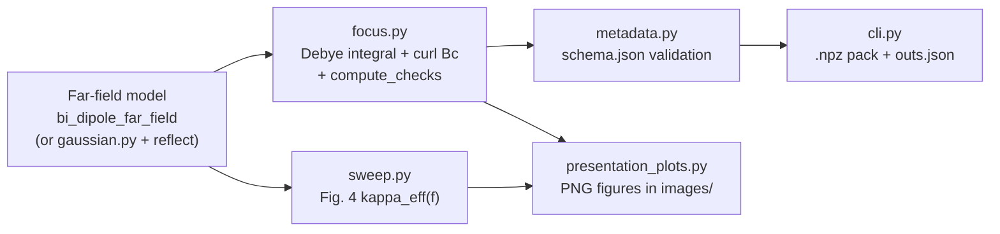

# `src/optics` Architecture & Reference

`src/optics` implements the bi-dipole focusing, paraxial beam-shaping, and focal-field generation half of `fsqed-laser-electron`, reproducing Olofsson & Gonoskov, *"Attaining a strong-field QED signal at laser-electron colliders with optimized focusing"*, Phys. Rev. A **106**, 063512 (2022).

It is decoupled from `src/particles`: the two packages communicate solely through compressed `.npz` **field packs** validated against `data/schema.json`.

---

## 1. Pipeline Overview



---

## 2. Global Conventions

- **Units:** All stored arrays, grids, frequencies, fields, and powers are in **SI units** ($\mathrm{m}$, $\mathrm{s}$, $\mathrm{rad/s}$, $\mathrm{V/m}$, $\mathrm{T}$, $\mathrm{W}$). Dimensionless ($a_0$, $\kappa$, $\chi$, $f$-number) and reference electron energy ($\mathrm{GeV}$) quantities are explicitly named.
- **Axes & Geometry:** Field arrays use slow-to-fast layout `(Nf, 3, Nz, Ny, Nx)` with spatial axes `(z, y, x)` and vector components `(x, y, z)` on axis `1`. Each spatial axis uses the centered even-grid convention `_centered_axis(span_m, npts)` (`step = span_m / npts`, `start = -(npts // 2) * step`, requiring even `Nx, Ny, Nz >= 2`). The laser propagates along $-\hat{\mathbf{y}}$ (converging from the $n_y < 0$ hemisphere to the focus at the origin) with linear polarization along $+\hat{\mathbf{z}}$ and magnetic field along $-\hat{\mathbf{x}}$, counter-propagating against electrons entering along $+\hat{\mathbf{y}}$.
- **Time-Harmonic Phasors:** Complex field phasors follow the $e^{+i\omega t}$ convention, $\mathbf{E}(\mathbf{r}, t) = \mathrm{Re}\!\left[\mathbf{E}_c(\mathbf{r})\,e^{+i\omega t}\right]$, under which Faraday's law gives $\mathbf{B}_c = \frac{i}{\omega}\nabla\times\mathbf{E}_c$.
- **Pulse Envelope:** Pulse durations $\tau_{\mathrm{FWHM}}$ use **intensity FWHM**; the Gaussian field-envelope width is $\sigma_t = \tau_{\mathrm{FWHM}} / \sqrt{4\ln 2}$ (`FWHM_TO_FIELD_SIGMA`), with $\tau_{\mathrm{FWHM}} = N_{\mathrm{cycles}}\lambda_0/c$.
- **f-Number & Aperture:** The parabolic mirror f-number is $f = L / (2 R_{\max})$ ($L$ focal length, $R_{\max}$ mirror radius). A paraxial ray at radius $R$ reflects at angle $\theta$ from the $-\hat{\mathbf{y}}$ axis with $R = 2L\tan(\theta/2)$, giving semi-aperture angle $\theta_{\max} = 2\arctan(1 / (4f))$ (`f_number_to_theta_max`); $f = 0.25$ yields $\theta_{\max} = \pi/2$ (full $-\hat{\mathbf{y}}$ hemisphere).

---

## 3. Module Breakdown

| Module | Key Exports | Responsibility |
| :--- | :--- | :--- |
| `constants.py` | `C_LIGHT`, `ETA_0`, `E_CRIT`, `B_CRIT`, `MC2_GEV`, `GAMMA_PER_GEV`, `FWHM_TO_FIELD_SIGMA`, `A_DIPOLE_1PW_1UM`, `A_BIDIPOLE_1PW_1UM`, `KAPPA_BIDIPOLE_MAX`, `omega_from_lambda`, `relativistic_field_scale`, `e_field_to_a0`, `tau_fwhm_to_sigma_t`, `theoretical_chi_max` | Self-contained CODATA SI constants, Schwinger scales, paper constants ($\kappa_{\max} = 5.25$, $a_{\mathrm{bidipole,1PW}} = 780/\sqrt{2}$), and unit/Eq. (1) scaling helpers. |
| `focus.py` | `bi_dipole_far_field`, `f_number_to_theta_max`, `mirror_normal`, `reflect`, `focal_field_angular_spectrum`, `focal_field_slice`, `magnetic_field_from_curl`, `field_power_through_y_plane`, `compute_checks` | Analytic bi-dipole far field, parabolic-mirror geometry, non-paraxial Debye $(\theta, \phi)$ quadrature (3D grid and 2D slices), finite-difference curl $\mathbf{B}_c$, Poynting flux, and self-checks. |
| `sweep.py` | `focal_field_vector`, `kappa_eff_vs_f_number`, `default_f_number_sweep` | Fast on-focus ($\mathbf{r}=\mathbf{0}$) Debye evaluation and $\kappa_{\mathrm{eff}}(f\text{-number})$ scan reproducing Fig. 4. |
| `gaussian.py` | `gaussian_source`, `thin_lens_phase`, `apodizer`, `propagate_angular_spectrum`, `beam_at_mirror`, `r_max_from_f_number` | Pre-mirror paraxial beam shaping: collimated Gaussian source, thin-lens phase, super-Gaussian/hard apodizer with power accounting, and 2D FFT angular-spectrum propagation. |
| `metadata.py` | `load_schema`, `validate`, `build_metadata` | Builds `schema_version: "1.0"` metadata dicts and validates against `data/schema.json` (using `jsonschema` with a built-in draft-07 subset fallback `_validate_local`). |
| `cli.py` / `__main__.py` | `default_parameters`, `generate_field_pack`, `save_field_pack`, `main` | CLI entrypoint (`python -m src.optics`) generating compressed `data/f{f_number}.npz` field packs and `outs.json` metadata. |
| `presentation_plots.py` | `draw_heatmap`, `draw_line_plot`, `image_focal_intensity`, `image_convergence`, `image_profile`, `image_kappa_sweep`, `image_farfield`, `main` | Standalone Pillow + NumPy script generating 5 presentation PNGs in `images/` without `matplotlib`. |

`src/optics/__init__.py` re-exports the submodules `constants`, `focus`, `gaussian`, `sweep`, and `metadata`, along with the CLI functions `default_parameters`, `generate_field_pack`, `save_field_pack`, and `main`.

---

## 4. How Each Stage Works

### 4.1 Bi-Dipole Far Field & Mirror Geometry (`focus.py`)
- `bi_dipole_far_field(n)` evaluates Eqs. (9)–(10) of Olofsson & Gonoskov (2022) for the Sheppard–Larkin electric-plus-magnetic dipole far field ($\mathbf{E}^e = (\hat{\mathbf{z}}\times\mathbf{n})\times\mathbf{n}$, $\mathbf{E}^b = \hat{\mathbf{x}}\times\mathbf{n}$). Given unit vectors $\mathbf{n} = (n_x, n_y, n_z)$ pointing from the focus toward the source ($n_y < 0$ hemisphere), it returns:
  $$\mathbf{E}_{\mathrm{ff}}(\mathbf{n}) = \bigl(n_x n_z,\ n_z(n_y - 1),\ n_y - n_x^2 - n_y^2\bigr)$$
  which satisfies $\mathbf{n}\cdot\mathbf{E}_{\mathrm{ff}} = 0$ identically.
- `f_number_to_theta_max(f_number)` computes $\theta_{\max} = 2\arctan(1 / (4 f\text{-number}))$.
- `mirror_normal(n)` computes the local parabolic-mirror normal $\mathbf{N} = (\hat{\mathbf{y}} - \mathbf{n}) / |\hat{\mathbf{y}} - \mathbf{n}|$, and `reflect(E, N)` applies local-normal polarization rotation $\mathbf{E}^p = \mathbf{E} - 2(\mathbf{E}\cdot\mathbf{N})\mathbf{N}$. Both `mirror_normal` and `reflect` are standalone helpers and are not yet wired into `cli.py` (which uses the analytic `bi_dipole_far_field` directly).

### 4.2 Vectorial Focal-Field Integral & Checks (`focus.py`)
- **Singularity-Free Debye Quadrature (`focal_field_angular_spectrum`, `focal_field_slice`):** Evaluates the exact non-paraxial Debye / Richards–Wolf integral (using exact $\mathbf{k}$-vectors rather than paraxial approximations) on a midpoint $\theta \in (0, \theta_{\max})$ grid (`ntheta`) and uniform $\phi \in [0, 2\pi)$ grid (`nphi`), with $\mathbf{n} = (\sin\theta\cos\phi, -\cos\theta, \sin\theta\sin\phi)$ and solid-angle weights $w = \sin\theta\,\Delta\theta\,\Delta\phi$. Parameterizing directly in $(\theta, \phi)$ avoids the $1/k_y$ Jacobian pole at the $\mathrm{NA}=1$ ($f = 0.25$) rim.
- **Power Normalization:** Computes $I_2 = \sum_{\theta,\phi} w\,|\mathbf{E}_{\mathrm{ff}}(\mathbf{n})|^2$, sets $C_{\mathrm{scale}} = \sqrt{2\eta_0 P / I_2}$ so total incoming power equals `power_w`, and sums:
  $$\mathbf{E}_c(\mathbf{r}) = -\frac{i}{\lambda_0} C_{\mathrm{scale}} \sum_{\theta,\phi} w\,\mathbf{E}_{\mathrm{ff}}(\mathbf{n})\,e^{-ik\,\mathbf{n}\cdot\mathbf{r}}$$
  returning `Ec` of shape `(1, 3, Nz, Ny, Nx)` (`complex128`). `focal_field_slice` evaluates the same integral on a 2D `"y"`, `"x"`, or `"z"` slice for fast visualization.
- **Magnetic Field & Poynting Flux:** `magnetic_field_from_curl` reconstructs $\mathbf{B}_c = \frac{i}{\omega}\nabla\times\mathbf{E}_c$ via central finite differences (`np.gradient`). `field_power_through_y_plane` integrates $S_y = \mathrm{Re}(E_z B_x^* - E_x B_z^*) / (2\mu_0)$ across a $y = \mathrm{const}$ plane (negative for $-\hat{\mathbf{y}}$ propagation).
- **Self-Checks (`compute_checks`):** Computes `a_max = max(|Ec|) / E_rel`, `a_max_expected = A_BIDIPOLE_1PW_1UM * sqrt(power_w / 1e15)`, `chi_max_per_GeV = 2 * GAMMA_PER_GEV * max(|E_perp|) / E_CRIT`, `power_conservation_rel_err = |p0 - p1| / |p0|` between `iy = Ny // 2` and `iy = max(Ny // 4, 0)`, and `max_location_m`.
- **Known Caveats:**
  - *`-1j` Gouy phase at focus vs. `particles` `t_ref = 0` check:* Because the Debye integral has prefactor $-i$ (`-1j`) and `bi_dipole_far_field` is real, $\mathbf{E}_c(\mathbf{0})$ is purely imaginary at the focus. `compute_checks` measures `max(|Ec|)` (complex modulus), whereas `src.particles.fields.load_field_pack` checks `a_max` from $\max|\mathrm{Re}[\mathbf{E}_c e^{i\omega t_{\mathrm{ref}}}]|$ at `t_ref_s = 0.0`, where $\mathrm{Re}[\mathbf{E}_c(\mathbf{0})] = \mathbf{0}$ and the real-part peak shifts off-focus by $\sim\lambda_0/4$.
  - *`pol="circular"` CLI/metadata flag:* `cli.py` / `generate_field_pack` now fail fast (`NotImplementedError`) when `pol != "z-linear"`, while `metadata.py` and `data/schema.json` retain `"circular"` support for future implementation (see `AGENTS.md`).

### 4.3 f-Number Sweep (`sweep.py`)
- `focal_field_vector` evaluates the Debye integral only at $\mathbf{r} = \mathbf{0}$ (where $e^{-ik\mathbf{n}\cdot\mathbf{r}} = 1$, so all rays interfere in phase: $\mathbf{E}_c(\mathbf{0}) = -\frac{i}{\lambda_0} C_{\mathrm{scale}}\sum_{\theta,\phi} w\,\mathbf{E}_{\mathrm{ff}}(\mathbf{n})$), making aperture scans cheap.
- `kappa_eff_vs_f_number` scans `f_numbers` (default `default_f_number_sweep()`: `0.25` plus 12 log-spaced points in `[0.35, 4.0]`) at `lambda0_m = 1.0e-6`, `power_w = 1.0e15`, `energy_gev = 1.0`, returning `f_number`, `chi_max_per_GeV`, and `a_max` (reproducing Fig. 4). At $f = 0.25$ (full $-\hat{\mathbf{y}}$ hemisphere), `chi_max_per_GeV` reaches $\kappa_{\mathrm{eff}} \approx 4.915$ (`a_max` $\approx 517.6$), approaching the full-$4\pi$ bi-dipole limit $\kappa_{\max} = 5.25$ (`KAPPA_BIDIPOLE_MAX`).

### 4.4 Pre-Mirror Paraxial Shaping (`gaussian.py`)
- Models optical shaping *before* the parabolic mirror only (focal fields are always computed non-paraxially via `focus.py`):
  - `gaussian_source(R, w0)`: collimated amplitude $\exp(-(R/w_0)^2)$ ($1/e$ field radius $w_0$).
  - `thin_lens_phase(R, focal_length_m, lambda0_m)`: thin-lens phase $\exp(-ikR^2/(2f))$.
  - `apodizer(R, R_max, order=1.0)`: super-Gaussian / hard-aperture transmission $\exp(-(R/R_{\max})^{2\,\mathrm{order}})$.
  - `propagate_angular_spectrum(U, dx, dz, dz_prop, lambda0_m)`: 2D FFT paraxial propagation $\mathcal{F}^{-1}\{\mathcal{F}\{U\}\exp(-i\,\Delta z_{\mathrm{prop}}(k_x^2+k_z^2)/(2k))\}$ on a `(nz, nx)` transverse slice.
  - `beam_at_mirror(...)`: applies `gaussian_source`, `thin_lens_phase`, and `apodizer`, returning `(U_shaped, transmission)` with radial power accounting $P_{\mathrm{out}}/P_{\mathrm{in}}$ via `np.trapezoid(|U|^2 R, R)`.
  - `r_max_from_f_number(focal_length_m, f_number)`: computes $R_{\max} = L/(2f)$.
- `gaussian.py` is currently standalone and not yet wired into `cli.py` or `sweep.py`.

### 4.5 Metadata, CLI & Plots (`metadata.py`, `cli.py`, `presentation_plots.py`)
- `metadata.py`: `build_metadata` constructs the `schema_version: "1.0"` dict (`grid`, `freqs=[omega0]`, `power_W`, `f_number`, `lambda0_m`, `pol`, `pulse` with `convention="intensity_fwhm"`, `checks`, plus non-schema reporting keys `convention`, `theta_max_rad`, and optional `n_cycles`, `R_max_m`) and validates it via `validate` against `data/schema.json`.
- `cli.py` (`python -m src.optics`): `default_parameters()` sets $\lambda_0 = 0.8\ \mu\mathrm{m}$, $f = 0.25$, $P = 1\ \mathrm{PW}$, `pol="z-linear"`, $5$-cycle FWHM pulse, `64^3` grid over `6.4e-6 x 4.0e-6 x 6.4e-6` m, `ntheta=32`, `nphi=64`. `generate_field_pack` builds `{"Ec", "Bc", "metadata"}` and `save_field_pack` writes compressed `data/f{f_number}.npz` alongside `outs.json`.
- `presentation_plots.py`: standalone script (`python src/optics/presentation_plots.py`) rendering `01_campo_focal_xz.png`, `02_convergencia_yz.png`, `03_perfil_campo.png`, `04_chi_vs_fnumber.png`, and `05_patron_angular.png` into `images/` using Pillow + NumPy.

---

## 5. Quick Usage & Verification

```python
from src.optics import cli, sweep

params = cli.default_parameters()
pack = cli.generate_field_pack(params)
npz_path = cli.save_field_pack(pack)

curve = sweep.kappa_eff_vs_f_number(sweep.default_f_number_sweep())
```

Generate the default field pack and `outs.json` from the CLI with `pixi run python -m src.optics`. Run tests with `pixi run test` (`tests/test_optics.py`).
