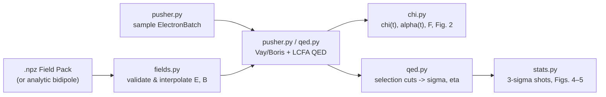

# `src/particles` Architecture & Reference

`src/particles` implements the relativistic electron-tracking, strong-field QED (LCFA) photon-emission, and collider-statistics half of `fsqed-laser-electron`, reproducing Olofsson & Gonoskov, *"Attaining a strong-field QED signal at laser-electron colliders with optimized focusing"*, Phys. Rev. A **106**, 063512 (2022).

It is decoupled from `src/optics`: the two packages communicate solely through compressed `.npz` **field packs** validated against `data/schema.json`.

---

## 1. Pipeline Overview



---

## 2. Global Conventions

- **Units:** All stored arrays, grids, fields, momenta, and timesteps are in **SI units** ($\mathrm{m}$, $\mathrm{s}$, $\mathrm{rad/s}$, $\mathrm{V/m}$, $\mathrm{T}$, $\mathrm{kg\cdot m/s}$). Dimensionless ($a_0, \gamma, \chi, \delta, \eta$) and reporting units ($\mathrm{GeV}$, $\mathrm{cm}^2$, $\mathrm{cm}^{-3}$) are explicitly named.
- **Axes & Geometry:** Field arrays use slow-to-fast layout `(Nf, 3, Nz, Ny, Nx)` with vector components `(x, y, z)` on axis `1`. Electrons enter along $+\hat{\mathbf{y}}$; the laser counter-propagates along $-\hat{\mathbf{y}}$.
  - `"z-linear"` (LP): at the focus, $\mathbf{E} \parallel \hat{\mathbf{z}}$ and $\mathbf{B} \parallel -\hat{\mathbf{x}}$ so $\mathbf{E} + \mathbf{v}\times\mathbf{B}$ adds constructively.
  - `"circular"` (CP): orthogonal bidipole modes with $\pi/2$ phase shift and $1/\sqrt{2}$ amplitude factor ($a_{\max}^{\mathrm{CP}} = a_{\max}/\sqrt{2}$ at equal power).
- **Time-Harmonic Phasors:** Real fields are synthesized on the fly via
  $$\mathbf{E}(\mathbf{r}, t) = g(t+\delta t)\sum_{k=0}^{N_f-1}\mathrm{Re}\!\left[\mathbf{E}_c^{(k)}(\mathbf{r})\,e^{+i\omega_k(t+\delta t)}\right]$$
  (and identically for $\mathbf{B}$). Under $e^{+i\omega_k t}$, Faraday's law gives $\mathbf{B}_c^{(k)} = \frac{i}{\omega_k}\nabla\times\mathbf{E}_c^{(k)}$.
- **Pulse Envelope:** Durations $\tau_{\mathrm{FWHM}}$ use **intensity FWHM**; the Gaussian field envelope is $g(t) = \exp\!\left(-(t-t_{\mathrm{ref}})^2/(2\sigma_t^2)\right)$ with $\sigma_t = \tau_{\mathrm{FWHM}}/\sqrt{4\ln 2}$. Applied only when $N_f = 1$ and `pulse.model == "gauss"`; multi-frequency stacks ($N_f > 1$) already encode the temporal envelope ($g \equiv 1$).

---

## 3. Module Breakdown

| Module | Key Exports | Responsibility |
| :--- | :--- | :--- |
| `constants.py` | `C_LIGHT`, `E_CRIT`, `MC2_GEV`, `energy_gev_to_gamma`, `e_field_to_a0`, `theoretical_chi_max` | CODATA SI constants, Schwinger scales ($E_{\mathrm{cr}}, B_{\mathrm{cr}}$), paper constants ($\kappa_{\max}=5.25$, $a_{\mathrm{bidipole,1PW}} = 780/\sqrt{2}$), and unit/Eq. (1) scaling helpers. |
| `fields.py` | `FieldPack`, `load_field_pack`, `save_field_pack`, `compute_bc_from_ec_curl`, `evaluate_eb`, `evaluate_eb_numba`, `make_analytic_bidipole_pack` | Boundary loader/validator, finite-difference curl fallback for missing `Bc`, Numba trilinear + temporal field synthesizer, and standalone exact Maxwell bidipole generator. |
| `pusher.py` | `ElectronBatch`, `TrajectoryResult`, `sample_electron_batch`, `step_vay_numba`, `step_boris_numba`, `propagate_ensemble` | Impact-parameter & jitter sampling, relativistic Vay (2008) / Boris integrators, and classical (no-recoil) ensemble propagation. |
| `chi.py` | `compute_chi`, `compute_chi_numba`, `compute_deviation_angle`, `compute_high_chi_time_fraction`, `compute_fig2_phase_space` | Instantaneous $\chi$, deviation angle $\alpha$ (unsigned polar or signed $z$ for LP Fig. 2), high-$\chi$ residence fraction $F$, and 2D $(\alpha, \chi)$ density histograms. |
| `qed.py` | `LCFATable`, `PhotonCatalog`, `QEDResult`, `build_lcfa_table`, `lcfa_rate_per_s`, `simulate_qed_ensemble`, `apply_selection_cuts`, `compute_sigma_and_eta` | Precomputed LCFA synchrotron tables, coupled trajectory + QED emission (`"monte_carlo"` and `"weighted"` modes), Sec. V selection cuts, and $(\sigma, \eta)$ computation. |
| `stats.py` | `ShotEstimate`, `estimate_shots_for_confidence`, `estimate_electron_loss_shots`, `f_number_to_opening_angle_deg`, `fig4_reference_curve`, `fig5_reference_contours` | $3\sigma$ shot-count estimates for photon vs. electron-loss diagnostics and analytical/digitized benchmark curves for Figs. 4 and 5. |

All public symbols are re-exported from `src/particles/__init__.py`.

---

## 4. How Each Stage Works

### 4.1 Field Packs & Interpolation (`fields.py`)
- `load_field_pack` parses `.npz` archives into frozen dataclasses (`FieldPack`, `GridSpec`, `PulseSpec`, `FieldChecks`), validates `metadata` against `data/schema.json`, and fails fast on schema errors or self-check violations (`checks.a_max` within `check_rtol=0.05` at $t_{\mathrm{ref}}$, `power_conservation_rel_err <= 0.10`).
- Legacy 4D `(Nf, Nz, Ny, Nx)` scalar $E_z$ arrays are auto-promoted to 5D when `pol == "z-linear"`. If `Bc` is omitted, `compute_bc_from_ec_curl` reconstructs it via central finite differences (`np.gradient`).
- `evaluate_eb_numba` performs trilinear interpolation of complex phasors and temporal synthesis at $t_{\mathrm{eff}} = t + \delta t$; points outside the grid return zero fields.
- `make_analytic_bidipole_pack` builds an exact regular spherical-Bessel bidipole solution (LP or CP; default $P = 100\ \mathrm{TW}$, $\lambda_0 = 0.8\ \mu\mathrm{m}$, $f = 0.25$, 5-cycle FWHM, $65^3$ grid over $[-2\lambda_0, 2\lambda_0]^3$) for standalone testing and `data/sample_field.npz`.

### 4.2 Ensemble Sampling & Trajectory Pushing (`pusher.py`, `chi.py`)
- `sample_electron_batch` draws impact parameters from $p(b) = 2b/b_{\max}^2$ via $b = b_{\max}\sqrt{u}$, azimuth $\phi \sim \mathcal{U}(0, 2\pi)$, initial momentum $\mathbf{p}_0 = (0, m_e c\sqrt{\gamma_0^2-1}, 0)$, and Gaussian timing jitter (`"per_shot"` or `"per_particle"`).
- `build_simulation_time_grid` defaults to $\Delta t = T_0/40$ and enforces $0 < \Delta t \le T_0/20$ ($T_0 = \lambda_0/c$).
- `step_vay_numba` (default) and `step_boris_numba` advance $(\mathbf{r}, \mathbf{p})$ in SI units. At each step, `chi.py` evaluates:
  $$\chi = \frac{\gamma}{E_{\mathrm{cr}}}\sqrt{\max\!\left(0,\ \|\mathbf{E} + c\boldsymbol{\beta}\times\mathbf{B}\|^2 - (\mathbf{E}\cdot\boldsymbol{\beta})^2\right)}, \qquad \alpha = \arctan2\!\left(\sqrt{p_x^2 + p_z^2},\ p_y\right)$$
  (or $\alpha_{\mathrm{signed}} = \arctan2(p_z, p_y)$ when `signed_z=True`).

### 4.3 LCFA QED Emission & Selection Cuts (`qed.py`)
- **LCFA Table (`build_lcfa_table`):** Precomputes the synchrotron rate $W_{\mathrm{rad}}(\gamma, \chi) = \frac{W_0}{\gamma} G(\chi)$ with $W_0 = \frac{\alpha_{\mathrm{fs}} m_e c^2}{\sqrt{3}\pi\hbar}$, tail fractions ($\delta > 0.01$, $\delta > 0.5$), mean $\delta$, and inverse CDF $\delta(\chi, q)$ on a log-spaced grid $\chi \in [10^{-4}, 2\times 10^3]$ (`128 x 128`) using the smooth $\delta = u^3$ substitution ($\tilde{y} = \frac{2}{3\chi}\frac{\delta}{1-\delta} \le 100$). Below $\chi_{\min}$ it uses the classical asymptote $G(\chi) = \frac{5\pi}{3}\chi$; above $\chi_{\max}$ it scales as $\chi^{2/3}$.
- **Simulation Modes (`simulate_qed_ensemble`):**
  - `"monte_carlo"`: At each step, emits a unit-weight photon with probability $P_{\mathrm{emit}} = 1 - e^{-W_{\mathrm{rad}}\Delta t}$, samples $\delta$ from `inv_cdf`, and applies collinear recoil $\mathbf{p} \leftarrow (1-\delta)\mathbf{p}$.
  - `"weighted"`: Variance-reduced deterministic integration for fast $(\varepsilon, P)$ scans. Tracks the non-depleted survival probability $P_{\mathrm{no\ loss}}(t) = \exp(-\int W_{\mathrm{rad}} f_{\delta > 0.01}\,dt)$ and mean Lorentz factor $\langle\gamma(t)\rangle$, recording weighted high-energy photons for both the fresh ($\gamma_0$) and depleted ($\gamma_{\mathrm{dep}} < 0.99\gamma_0$) branches.
- **Selection Cuts & Observables (`apply_selection_cuts`, `compute_sigma_and_eta`):**
  - **Total detected ($N_{\mathrm{total}}$):** $\delta_{\mathrm{init}} = \frac{\hbar\omega}{\gamma_0 m_e c^2} > 0.5$ and $\alpha > c_{\mathrm{pol}}\frac{a_{\max}}{\gamma_0}$ ($c_{\mathrm{pol}} = 0.6$ for `"z-linear"`, $0.7$ for `"circular"`).
  - **Signal ($N_{\mathrm{signal}} \subseteq N_{\mathrm{total}}$):** additionally $\chi_{\mathrm{emit}} > \chi_{\max}/2$ and $\gamma_{\mathrm{prior}} \ge 0.99\,\gamma_0$.
  - **Observables:** $\eta = W_{\mathrm{signal}} / W_{\mathrm{total}}$ and $\sigma_{\mathrm{m}^2} = \pi b_{\max}^2 (T_{\mathrm{inj}}/\tau_l)(W_{\mathrm{signal}} / N_e)$, converted to $\sigma_{\mathrm{cm}^2} = 10^4\,\sigma_{\mathrm{m}^2}$.

### 4.4 Shot Statistics & Benchmarks (`stats.py`)
- `estimate_shots_for_confidence`: Given $(\sigma_{\mathrm{cm}^2}, \eta, n_e, \tau_l)$, computes $N_{\mathrm{total,1}} = \sigma_{\mathrm{cm}^2} n_e \tau_l c_{\mathrm{cm/s}}$, $N_{\mathrm{signal,1}} = \eta N_{\mathrm{total,1}}$, $N_{\mathrm{total,req}} = (Z / (\delta_R\eta))^2$, and $N_{\mathrm{shots}} = N_{\mathrm{total,req}} / N_{\mathrm{total,1}}$.
- `estimate_electron_loss_shots`: Compares against direct electron energy-loss detection using $\ell_{\mathrm{mfp}}/\lambda = 15\chi^{1/3}/a_{\max}$ and survival $\eta_e = \exp(-L_{\mathrm{prop}}/\ell_{\mathrm{mfp}})$.
- `fig4_reference_curve` and `fig5_reference_contours` provide theoretical/benchmark curves for the truncated bidipole focusing scan and $\chi_{\max}/2 \in \{1, 10, 100, 1000\}$ contours.

---

## 5. Quick Usage & Verification

```python
import numpy as np
from src.particles import (
    load_field_pack, sample_electron_batch,
    simulate_qed_ensemble, compute_sigma_and_eta, estimate_shots_for_confidence,
)

pack = load_field_pack("data/sample_field.npz")
batch = sample_electron_batch(
    n_particles=200, energy_gev=10.0,
    b_max_m=1.5 * pack.lambda0_m, y0_m=pack.grid.y0_m,
    rng=np.random.default_rng(42),
)
res = simulate_qed_ensemble(pack, batch, mode="weighted", method="vay")
obs = compute_sigma_and_eta(
    res.photons, pol=pack.pol, a_max=pack.checks.a_max,
    chi_max=pack.checks.chi_max_per_GeV * batch.energy_gev,
    b_max_m=batch.b_max_m, n_electrons=batch.r0_m.shape[0],
)
shots = estimate_shots_for_confidence(obs["sigma_cm2"], obs["eta"], tau_l_s=pack.pulse.tau_fwhm_s)
```

Run tests with `pixi run test` (`tests/test_particles.py`). End-to-end plots reproducing Figs. 2, 4, and 5 are in `notebooks/sample.ipynb`.
